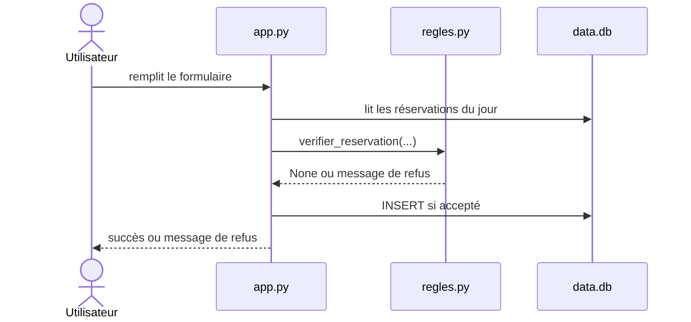
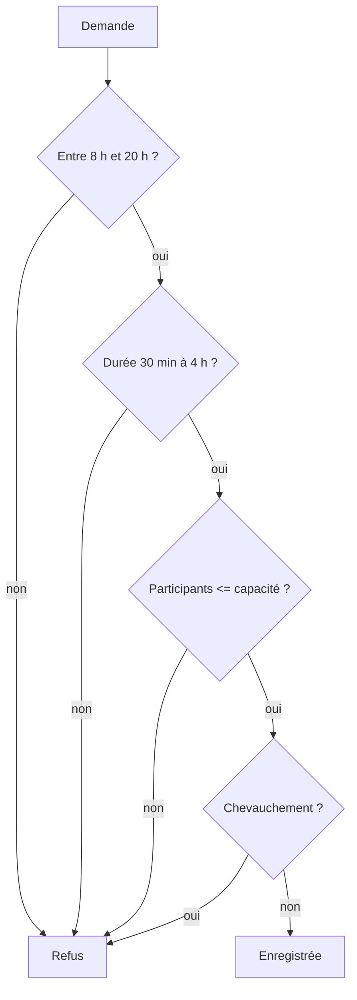

# Expliquer le code

## Étapes

1. Lis `git diff`. S'il est vide, lis `git diff HEAD~1` et dis lequel tu as utilisé.
2. Écris un résumé de 5 lignes maximum : ce qui change et pourquoi, pas comment.
3. Dessine un diagramme de séquence Mermaid de l'utilisateur jusqu'à la base.
4. Dessine un flowchart Mermaid des décisions prises par le code (les refus, les cas d'erreur).
5. Ne modifie aucun fichier.

## Forme

````markdown
## Résumé
5 lignes maximum.

## Séquence


## Décisions

````

## Interdit

- Modifier des fichiers.
- Inventer un comportement qui n'est pas dans le diff.
- Dépasser 5 lignes de résumé.
