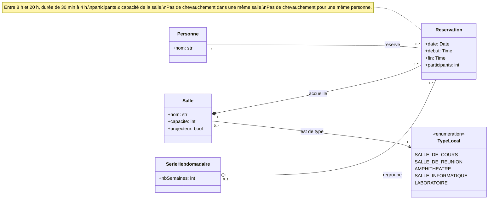
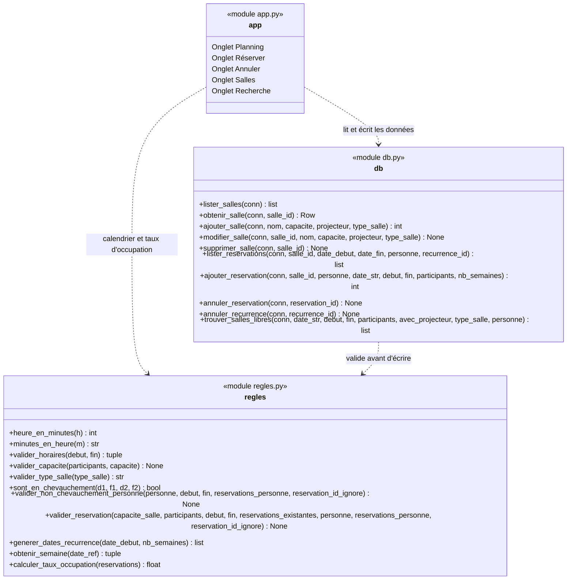

# Diagramme de classes - Réservation de salles

Ce document présente le diagramme de classes du système de réservation de salles après nos ajouts (contrainte par personne, type de local, réservations répétées chaque semaine), puis l'architecture du code (Streamlit, SQLite, Python).

## 1. Diagramme de classes (modèle du domaine)

### Lecture du diagramme

- **Salle — Reservation** : composition. Supprimer une salle supprime ses réservations (`ON DELETE CASCADE` dans `base.sql`).
- **TypeLocal** (ajout B2) : chaque salle a exactement un type, choisi dans une liste fixe (`TYPES_SALLES_DEFAUT` dans `regles.py`).
- **Personne** (ajout B1) : une personne peut avoir plusieurs réservations, mais jamais deux qui se chevauchent, toutes salles confondues.
- **SerieHebdomadaire** (ajout B3) : une réservation répétée chaque semaine crée une série d'occurrences, qui peuvent être annulées ensemble. Une réservation simple n'appartient à aucune série.

### Correspondance avec la base de données

Le diagramme est conceptuel : toutes les classes n'ont pas leur propre table.

| Classe | Dans la base |
|---|---|
| `Salle` | table `salles` |
| `TypeLocal` | colonne `salles.type` (texte) |
| `Reservation` | table `reservations` |
| `Personne` | colonne `reservations.personne` (texte, comparé sans tenir compte de la casse ni des espaces) |
| `SerieHebdomadaire` | colonne `reservations.recurrence_id`, commune à toutes les occurrences d'une série |

Comme il n'y a pas d'authentification, une personne est identifiée uniquement par son nom.

## 2. Architecture du code

Le code n'est pas orienté objet : il est organisé en trois modules de fonctions. Le schéma ci-dessous montre ces modules et leurs dépendances, pas des classes.

### Description des modules

1. **Règles métier (`regles.py`)** : fonctions pures, indépendantes de la base et de Streamlit, donc faciles à tester. Elles contrôlent la plage horaire (8 h - 20 h), la durée (30 min - 4 h), la capacité, les chevauchements par salle et par personne, le type de local, et calculent les dates d'une série hebdomadaire, les bornes de la semaine et le taux d'occupation.

2. **Accès aux données (`db.py`)** : contient toutes les requêtes SQL. Chaque écriture passe d'abord par les règles métier. Pour une série hebdomadaire, toutes les occurrences sont validées avant la première insertion : si une seule est refusée, rien n'est enregistré.

3. **Interface (`app.py`)** : cinq onglets Streamlit — planning hebdomadaire avec export CSV, réservation (simple ou répétée), annulation (une réservation ou toute une série), gestion des salles et recherche d'une salle libre.
