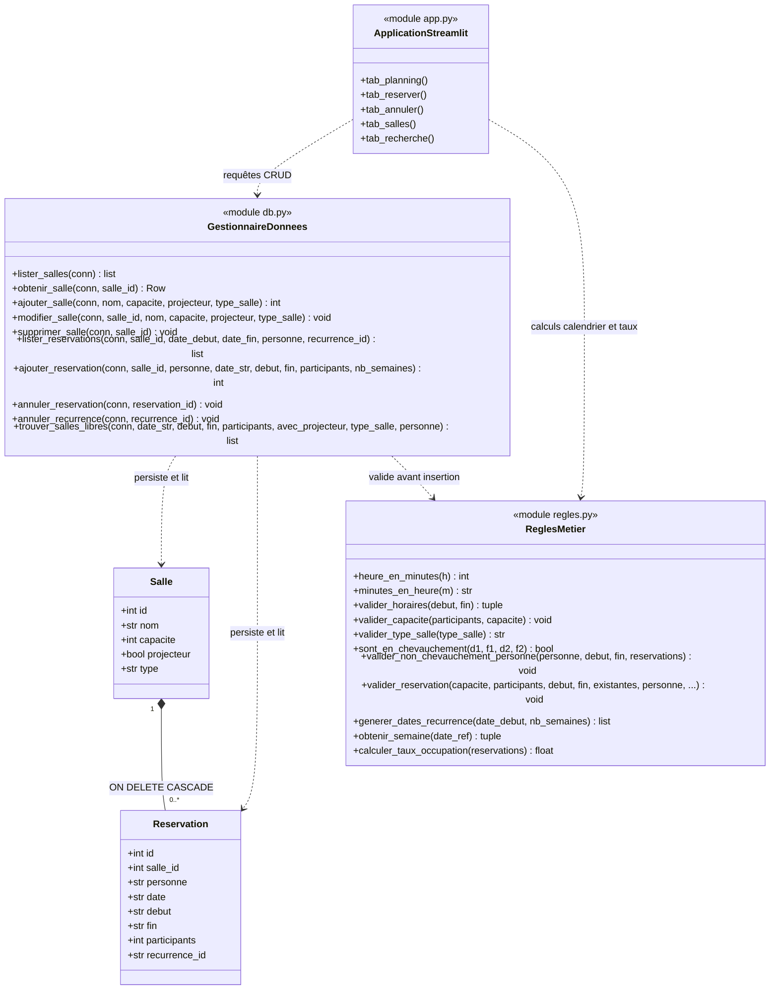

# Diagramme de classes - Réservation de salles

Ce document présente l'architecture logicielle et le diagramme de classes du système de réservation de salles (Streamlit, SQLite, Python).

---

## Description des composants

1. **Entités de données (`Salle`, `Reservation`)** :
   - `Salle` représente un local avec son nom, sa capacité maximale, la présence ou non d'un projecteur, ainsi que son `type` (ex. *Salle de cours*, *Salle de réunion*, *Amphithéâtre*, etc.).
   - `Reservation` associe une salle à une personne sur une date et une plage horaire donnée (`debut` - `fin`), avec un nombre de participants. Si la réservation est hebdomadaire, elle partage un `recurrence_id` commun avec ses occurrences sœurs.
   - La relation entre `Salle` et `Reservation` est une composition avec contrainte d'intégrité référentielle `ON DELETE CASCADE` : la suppression d'une salle entraîne automatiquement la suppression de ses réservations.

2. **Règles métier pures (`regles.py`)** :
   - Fonctions pures indépendantes de la base de données et du framework d'affichage.
   - Contrôle la plage horaire (8 h - 20 h) et la durée autorisée (30 min - 4 h).
   - Contrôle le non-dépassement de la capacité.
   - Empêche les chevauchements temporels pour une même salle.
   - Empêche les chevauchements pour une même personne (une personne ne peut pas avoir deux réservations en même temps).
   - Valide le type de local et calcule les récurrences hebdomadaires, les bornes de la semaine (lundi au dimanche) et le taux d'occupation.

3. **Couche d'accès aux données (`db.py`)** :
   - Centralise l'ensemble des requêtes SQL et transactions SQLite.
   - Valide les règles métier avant toute écriture.
   - Garantit l'atomicité lors de la réservation de séries récurrentes.

4. **Interface utilisateur Streamlit (`app.py`)** :
   - Coordonne les 5 vues principales : planning hebdomadaire avec export CSV, formulaire de réservation (unique ou récurrente), annulation unitaire ou par série, gestion du parc de salles et recherche multicritère de salles libres.
